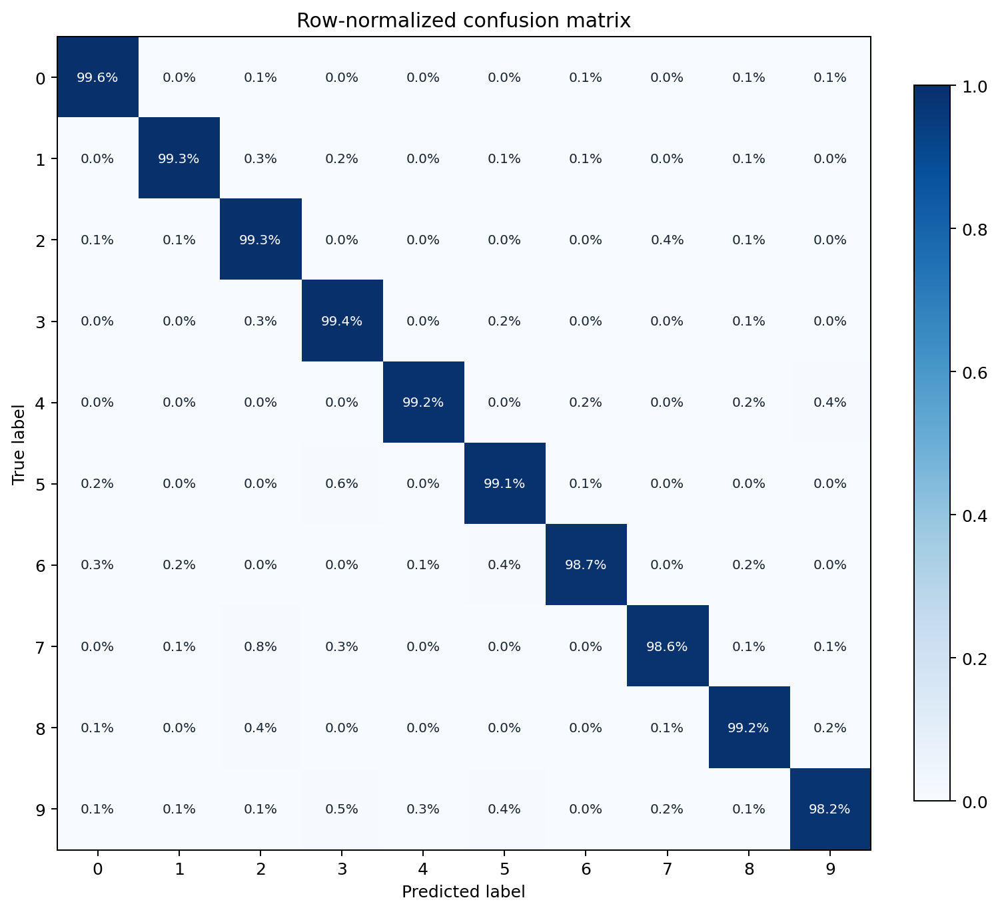
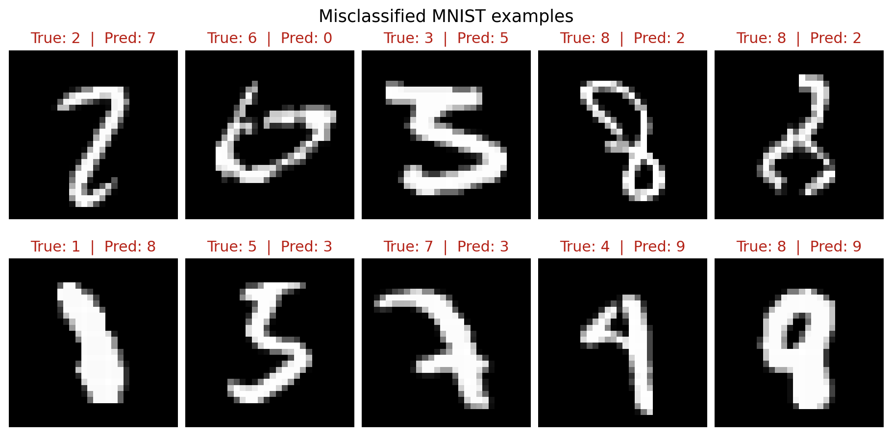
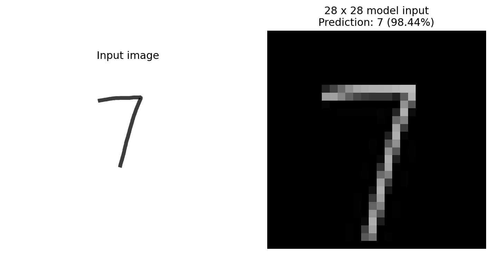

# MNIST CNN Reproduction

[English](#english) | [简体中文](#简体中文)

<a id="english"></a>

## English

A compact, reproducible PyTorch MNIST CNN learning project. It records two related exercises: running the PyTorch `examples/mnist` reference and independently reimplementing its CNN training and evaluation workflow. This is an educational reproduction, not a new architecture or a research paper.

### Results

| Checkpoint | Test split | Correct | Accuracy | Provenance |
|---|---:|---:|---:|---|
| `models/official_mnist_cnn.pt` | MNIST test, 10,000 images | 9,915 | 99.15% | Existing checkpoint from the PyTorch example run |
| `models/my_mnist_can.pt` | MNIST test, 10,000 images | 9,907 | 99.07% | Existing checkpoint from the independent five-epoch implementation |
| `assets/my_digits.png` | One hand-drawn digit | 7 | 98.44% confidence | Re-evaluated with the included custom-image preprocessing |

The counts were checked locally against the torchvision MNIST test split and the included checkpoint files. Training was not repeated while preparing this repository. Both checkpoints are retained as inference-ready `state_dict` files; no dataset copy is committed.

### Network and training

Input is one grayscale image of shape `1 x 28 x 28`. The model uses two 3 x 3 convolutions (32, then 64 channels), ReLU activations, 2 x 2 max pooling, dropout (0.25), flattening, a 128-unit fully connected layer, dropout (0.5), a 10-class output layer, and `LogSoftmax`. Training uses `NLLLoss`, Adadelta (`lr=1.0`), and `StepLR(step_size=1, gamma=0.7)`. Images are converted to tensors and normalized with MNIST mean 0.1307 and standard deviation 0.3081.

After the second convolution and pooling, the feature map is `64 x 12 x 12` (9,216 values), which feeds the first fully connected layer.

### Repository contents

```text
mnist-cnn-reproduction/
├── assets/
│   ├── figures/                 # Real evaluation figures and machine-readable metrics
│   └── my_digits.png            # Included hand-drawn input
├── models/
│   ├── my_mnist_can.pt          # Verified independent five-epoch checkpoint
│   └── official_mnist_cnn.pt    # Verified PyTorch example checkpoint
├── main.py                      # Example-style training entry point (14 epochs by default)
├── my_mnist.py                  # Independent five-epoch training entry point
├── model.py                     # Shared CNN definition
├── predict.py                   # Test-set evaluation, CSV metrics, and figures
├── predict_custom.py            # Preprocess and predict an external digit image
├── requirements.txt
├── LICENSE
└── README.md
```

The original MNIST data, virtual environments, caches, and the known random-initialization checkpoint `my_mnist_cnn.pt` are not included. That checkpoint evaluated at 964/10,000 (9.64%) and is deliberately excluded. Training scripts write to `runs/` and refuse to replace an existing output unless `--overwrite` is supplied.

### Environment and setup

Verified with Python 3.9.13, PyTorch 2.8.0+cu126, torchvision 0.23.0+cu126, matplotlib 3.9.4, Pillow 11.3.0, and an NVIDIA GeForce RTX 4060 Laptop GPU. CPU inference is also supported. CUDA-enabled PyTorch and torchvision builds must be compatible with the machine where you run them.

Create an environment and install the listed Python packages:

```bash
python -m venv .venv
# Windows PowerShell: .venv\Scripts\Activate.ps1
# macOS/Linux: source .venv/bin/activate
python -m pip install -r requirements.txt
```

The requirements file lists compatible ranges rather than pinning a particular CUDA wheel. Use the official PyTorch installation selector if you need a CUDA-specific build.

### Train

Run the reference-style entry point (14 epochs by default):

```bash
python main.py --save-model
```

Run the independent five-epoch implementation:

```bash
python my_mnist.py
```

Both commands download MNIST to the repository-local `data/` directory if it is missing. The reference-style script saves only with `--save-model`. Outputs default to `runs/`; choose another path with `--output`. If that path already exists, the script stops unless `--overwrite` is explicitly added.

Optional CPU execution and training settings:

```bash
python my_mnist.py --no-accel --epochs 5 --batch-size 64 --seed 1
```
### Evaluate and reproduce the figures

Evaluate the included checkpoint without training:

```bash
python predict.py --model models/my_mnist_can.pt
```

This checks all 10,000 test images and writes raw and row-normalized confusion matrices, correct and incorrect example grids, per-class CSV metrics, and `evaluation_summary.json` under `assets/figures/`. Confusion-matrix rows are true labels and columns are predicted labels. To evaluate the reference checkpoint, pass `--model models/official_mnist_cnn.pt`. On this checkpoint, digit 9 has the lowest per-class accuracy (991/1,009; 98.22%), and the most frequent one-way confusion is a true 7 predicted as 2 (8 images).

The committed figures are generated from the included independent checkpoint and actual MNIST test data. Their source metrics are saved next to them for verification.

<p align="center"></p>

<p align="center"></p>

<p align="center"></p>

### Predict a hand-drawn image

Run inference on the included image; this command does not need to download MNIST:

```bash
python predict_custom.py --image assets/my_digits.png
```

Or pass your own PNG, JPEG, or BMP image:

```bash
python predict_custom.py --image path/to/my_digit.png --model models/my_mnist_can.pt
```

Preprocessing converts the image to grayscale, conditionally inverts light backgrounds, applies autocontrast, crops the digit, scales its longer side to at most 20 pixels, centers its brightness mass on a black 28 x 28 canvas, then applies the MNIST normalization. This heuristic is intended for one clearly separated digit per image; handwriting and backgrounds unlike MNIST can change predictions.

### Relationship to the PyTorch example and attribution

`main.py` follows and adapts the single-file training/evaluation workflow in [pytorch/examples/mnist/main.py](https://github.com/pytorch/examples/blob/main/mnist/main.py). The network shape, NLL loss, Adadelta optimizer, and StepLR schedule follow that reference. Repository-relative paths, the shared model definition, output overwrite protection, the independent five-epoch implementation, and the analysis/inference utilities are project additions. This repository does not contain the full `pytorch/examples` repository.

The adapted example code retains the upstream BSD 3-Clause attribution. See [LICENSE](LICENSE). MNIST is downloaded at runtime through torchvision and is not bundled here.

---

<a id="简体中文"></a>

## 简体中文

这是一个紧凑、可复现的 PyTorch MNIST CNN 学习项目，记录了两项相关实践：运行 PyTorch `examples/mnist` 参考示例，以及独立重写 CNN 训练和评估流程。本项目是学习复现，不提出新的网络结构，也不是科研论文。

### 实验结果

| 权重文件 | 测试集 | 正确数量 | 准确率 | 来源 |
|---|---:|---:|---:|---|
| `models/official_mnist_cnn.pt` | MNIST 测试集，10,000 张 | 9,915 | 99.15% | 已有的 PyTorch 示例运行权重 |
| `models/my_mnist_can.pt` | MNIST 测试集，10,000 张 | 9,907 | 99.07% | 独立实现训练 5 轮所得权重 |
| `assets/my_digits.png` | 一张手绘数字 | 7 | 置信度 98.44% | 使用仓库内预处理流程重新推理 |

以上数量已使用 torchvision MNIST 测试集和仓库内权重在本机核验。整理仓库期间没有重新训练。两份权重以可直接推理的 `state_dict` 格式保留；仓库不包含数据集副本。

### CNN 结构与训练设置

输入为 `1 x 28 x 28` 单通道灰度图。网络包含两层 3 x 3 卷积（通道数依次为 32、64）、ReLU、2 x 2 最大池化、Dropout（0.25）、展平、128 单元全连接层、Dropout（0.5）、10 类输出层及 `LogSoftmax`。训练使用 `NLLLoss`、Adadelta（`lr=1.0`）和 `StepLR(step_size=1, gamma=0.7)`。图像转为 Tensor 后按 MNIST 均值 0.1307、标准差 0.3081 标准化。

第二层卷积和池化后的特征尺寸为 `64 x 12 x 12`，即 9,216 个特征，再输入第一个全连接层。

### 文件结构

```text
mnist-cnn-reproduction/
├── assets/
│   ├── figures/                 # 实际评估图表和机器可读指标
│   └── my_digits.png            # 随附手绘图
├── models/
│   ├── my_mnist_can.pt          # 已核验的独立实现权重
│   └── official_mnist_cnn.pt    # 已核验的 PyTorch 示例权重
├── main.py                      # 参考官方示例的训练入口，默认 14 轮
├── my_mnist.py                  # 独立实现的训练入口，默认 5 轮
├── model.py                     # 共用 CNN 定义
├── predict.py                   # 测试集评估、CSV 指标和可视化
├── predict_custom.py            # 外部图片预处理与推理
├── requirements.txt
├── LICENSE
└── README.md
```

原 MNIST 数据目录、虚拟环境、缓存，以及已确认是随机初始化状态的 `my_mnist_cnn.pt` 均不包含在新仓库中。该误保存文件的测试结果为 964/10,000（9.64%），因此不会被用作推理权重。训练脚本将结果写入 `runs/`；若输出已存在会停止，只有显式传入 `--overwrite` 才会覆盖。

### 环境与依赖

本项目在以下环境核验：Python 3.9.13、PyTorch 2.8.0+cu126、torchvision 0.23.0+cu126、matplotlib 3.9.4、Pillow 11.3.0、NVIDIA GeForce RTX 4060 Laptop GPU。也支持 CPU 推理。使用 CUDA 时，PyTorch 与 torchvision 的构建版本必须和运行机器兼容。

创建虚拟环境并安装清单中的 Python 包：

```bash
python -m venv .venv
# Windows PowerShell：.venv\Scripts\Activate.ps1
# macOS/Linux：source .venv/bin/activate
python -m pip install -r requirements.txt
```

依赖文件提供兼容版本范围，不固定特定 CUDA wheel。需要 CUDA 时，请按官方 PyTorch 安装选择器选择对应构建。

### 训练

运行参考官方示例的入口（默认 14 轮）：

```bash
python main.py --save-model
```

运行独立实现的 5 轮训练：

```bash
python my_mnist.py
```

如果本地没有数据，两条命令都会将 MNIST 下载到仓库内的 `data/`。参考示例入口只有传入 `--save-model` 才会保存。默认输出位于 `runs/`，可用 `--output` 指定路径；若目标文件已存在，脚本会停止，除非显式添加 `--overwrite`。

可选 CPU 训练和参数设置：

```bash
python my_mnist.py --no-accel --epochs 5 --batch-size 64 --seed 1
```

### 测试集评估与可视化

无需重新训练，直接评估随附权重：

```bash
python predict.py --model models/my_mnist_can.pt
```

脚本评估完整的 10,000 张测试图片，并在 `assets/figures/` 生成原始和按真实类别归一化的混淆矩阵、正确与错误样本示例图、逐类 CSV 和 `evaluation_summary.json`。混淆矩阵的行是真实标签，列是预测标签。要评估官方示例权重，可传入 `--model models/official_mnist_cnn.pt`。在这份权重上，数字 9 的逐类准确率最低（991/1,009，98.22%）；出现次数最多的单向混淆是真实数字 7 被预测成 2（8 张）。

仓库中的图表由独立实现权重和实际 MNIST 测试集生成。图表旁保存了源指标，便于直接核对具体数字。
可视化内容包括逐类归一化混淆矩阵、真实误分类样本和手绘数字的模型输入与预测结果；上方图片来自本仓库刚生成的评估产物。

### 自绘数字与外部图片预测

预测随附手绘图（此命令不需要下载 MNIST）：

```bash
python predict_custom.py --image assets/my_digits.png
```

也可以输入自己的 PNG、JPEG 或 BMP 图片：

```bash
python predict_custom.py --image path/to/my_digit.png --model models/my_mnist_can.pt
```

预处理会将图片转为灰度图，根据整体亮度判断是否反色，自动增强对比度、裁剪数字、将最长边缩放到不超过 20 像素，再按亮度重心将数字放到黑色 28 x 28 画布中央，最后应用与 MNIST 训练相同的标准化。此启发式流程面向一张图中单个、清晰分离的数字；笔迹或背景与 MNIST 差异较大时，预测可能变化。

### 与 PyTorch 官方示例的关系及署名

`main.py` 参考并整理自 [pytorch/examples/mnist/main.py](https://github.com/pytorch/examples/blob/main/mnist/main.py) 的单文件训练与评估流程。网络形状、NLL 损失、Adadelta 优化器和 StepLR 调度方式沿用该参考实现。仓库内相对路径、共用模型定义、输出覆盖保护、独立实现的五轮训练代码、分析和图片推理工具是本项目的整理与扩展。本仓库没有包含或复制完整的 `pytorch/examples` 仓库。

参考代码保留上游 BSD 3-Clause 署名，完整许可文本见 [LICENSE](LICENSE)。MNIST 数据由 torchvision 在运行时下载，本仓库不打包数据集。
